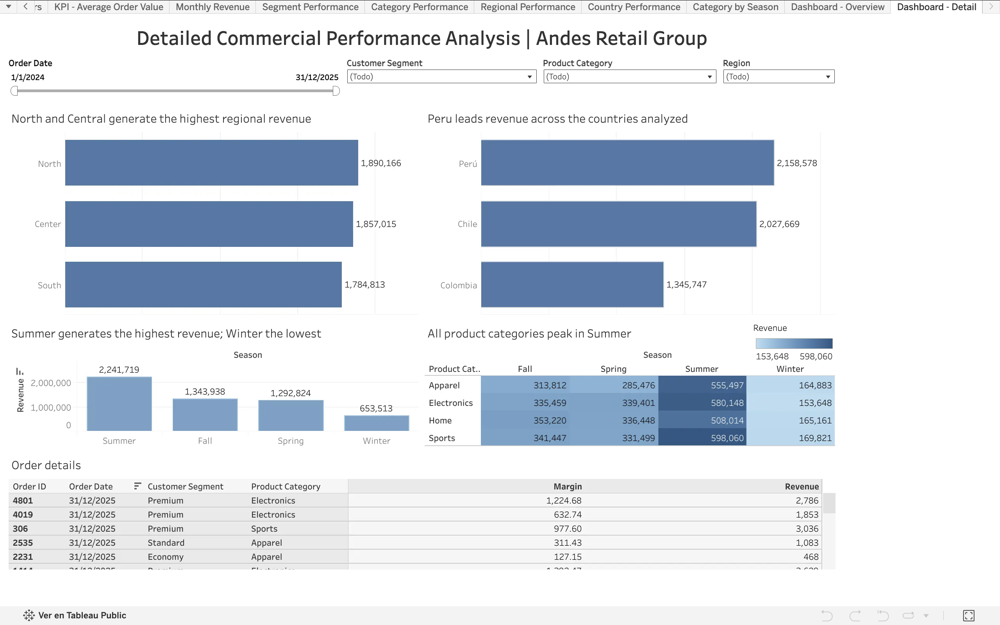

# Andes Retail Commercial Performance 2024–2025

**Author:** Rodrigo Garza García  
**Role:** Strategy & Public Affairs | Business Analysis & Data Analytics  
**Portfolio:** [GitHub Profile](https://github.com/rogarzag)

Commercial performance analysis and interactive Tableau dashboard for **Andes Retail Group**, covering revenue, margin, orders, customer segments, product categories, geography, and seasonality across 2024–2025.

## 📊 Interactive Dashboard

Explore the full interactive dashboard on Tableau Public:

[View Dashboard on Tableau Public](https://public.tableau.com/app/profile/rodrigo.garza.garc.a/viz/Andes_Retail_Commercial_Performance_2024_2025/Dashboard-Overview)

## 🎯 Business Objective

This project analyzes how commercial performance evolved between 2024 and 2025 and explores the geographic, seasonal, customer, and product patterns associated with those changes.

Two complementary dashboards were developed:

- **Dashboard - Overview:** executive view of KPIs, monthly trends, customer segments, and product categories.
- **Dashboard - Detail:** deeper analysis of geographic, seasonal, and product performance, including order-level detail.

## 📈 Dashboard - Overview

### Main KPIs

| Metric | 2024 | 2025 | Change |
|---|---:|---:|---:|
| Revenue | 2,863,384 | 2,668,610 | **-6.8%** |
| Margin | 1,005,811.62 | 935,937.71 | **-6.9%** |
| Orders | 2,550 | 2,450 | **-3.9%** |
| Average Order Value | 1,122.90 | 1,089.23 | Decreased |

Across both years, Andes Retail Group generated **5.53M in revenue, 1.94M in margin, and 5,000 orders**.

## 🔎 Dashboard - Detail

## 💡 Key Findings

- Revenue declined by approximately **6.8% in 2025**, accompanied by lower margin, order volume, and Average Order Value.
- **Home moved from the lowest-revenue category in 2024 to the highest-revenue category in 2025.**
- The **Economy** customer segment consistently generated the lowest revenue and margin.
- **Peru** generated the highest revenue among the countries analyzed.
- **Summer generated more than three times the revenue of Winter.**
- All product categories reached their highest revenue during Summer.
- Monthly performance was weaker between **June and August**, followed by a rebound toward year-end.

## 📌 Recommended Next Steps

- Investigate the drivers behind Home's change in category leadership.
- Analyze the factors associated with the June–August slowdown.
- Identify opportunities to strengthen performance during lower-activity periods.
- Compare category performance by region, season, order volume, and Average Order Value before drawing causal conclusions.

## 🛠 Tools

- Tableau Public
- Business Analysis
- Data Visualization
- KPI Analysis
- Dashboard Design
- SCQA Business Communication

## 📓 Analysis Notebook

The portfolio version of the project notebook is available in this repository:

[`andes_retail_commercial_performance_portfolio.ipynb`](andes_retail_commercial_performance_portfolio.ipynb)

## 🔗 Tableau Public

[Explore the interactive workbook](https://public.tableau.com/app/profile/rodrigo.garza.garc.a/viz/Andes_Retail_Commercial_Performance_2024_2025/Dashboard-Overview)
