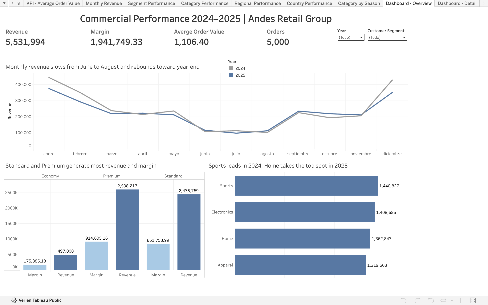

# Andes Retail Commercial Performance 2024–2025

**Author:** [Rodrigo Garza García](https://www.linkedin.com/in/rodrigogarzamx/)  
**Professional focus:** Public & International Affairs · Business Analysis · Data Analytics  
**Portfolio page:** [andes retail commercial performance](https://rogarzag.github.io/projects/andes-retail/)  
**GitHub repository:** [andes-retail-commercial-performance](https://github.com/rogarzag/andes-retail-commercial-performance)  
**Project focus:** Business Analysis · Data Analytics · Commercial Performance · KPI Dashboards · Tableau  
**Project context:** Data Analytics portfolio project  
**Data / case coverage:** 2024–2025  
**Professional links:** [GitHub profile](https://github.com/rogarzag) · [LinkedIn](https://www.linkedin.com/in/rodrigogarzamx/) · [Professional Website](https://rogarzag.github.io/)

## Project Overview

Commercial performance analysis and interactive Tableau dashboard for **Andes Retail Group**, covering revenue, margin, orders, customer segments, product categories, geography, and seasonality across 2024–2025.

## 📊 Interactive Dashboard

Explore the full interactive dashboard on Tableau Public:

[View Dashboard on Tableau Public](https://public.tableau.com/app/profile/rodrigo.garza.garc.a/viz/Andes_Retail_Commercial_Performance_2024_2025/Dashboard-Overview)

## 🎯 Business Objective

This project analyzes how commercial performance evolved between 2024 and 2025 and explores the geographic, seasonal, customer, and product patterns associated with those changes.

Two complementary dashboards were developed:

- **Dashboard - Overview:** executive view of KPIs, monthly trends, customer segments, and product categories.
- **Dashboard - Detail:** deeper analysis of geographic, seasonal, and product performance, including order-level detail.

## Executive Summary

Revenue declined **6.8% in 2025**, alongside fewer orders and a lower average order value. At the same time, **Home moved from the lowest-revenue category to the highest**.

The immediate priority is to understand where order volume and purchase value weakened, and how the change in category performance relates to the overall decline.

## 📈 Dashboard - Overview

### Main KPIs

| Metric | 2024 | 2025 | Change |
|---|---:|---:|---:|
| Revenue | 2,863,384 | 2,668,610 | **-6.8%** |
| Margin | 1,005,811.62 | 935,937.71 | **-6.9%** |
| Orders | 2,550 | 2,450 | **-3.9%** |
| Average Order Value | 1,122.90 | 1,089.23 | Decreased |

Across both years, Andes Retail Group generated **5.53M in revenue, 1.94M in margin, and 5,000 orders**.

## 🔎 Dashboard - Detail

## 💡 Key Findings

- Revenue declined by approximately **6.8% in 2025**, accompanied by lower margin, order volume, and Average Order Value.
- **Home moved from the lowest-revenue category in 2024 to the highest-revenue category in 2025.**
- The **Economy** customer segment consistently generated the lowest revenue and margin.
- **Peru** generated the highest revenue among the countries analyzed.
- **Summer generated more than three times the revenue of Winter.**
- All product categories reached their highest revenue during Summer.
- Monthly performance was weaker between **June and August**, followed by a rebound toward year-end.

## Recommendations Based on the Findings

| Finding | Business meaning | Recommendation |
|---|---|---|
| Revenue fell 6.8%, orders fell 3.9%, and average order value decreased. | The decline involves both fewer purchases and lower spending per order. | Review orders and average order value by category and customer segment to identify where the decline is concentrated. |
| Home moved from the lowest-revenue category to the highest. | The relative contribution of product categories changed. | Compare Home's results with the other categories before changing commercial priorities; a higher rank alone does not prove growth. |
| Economy generates the lowest revenue and margin amount. | It contributes less in total than the other segments. | Review its order volume and average order value before deciding how much commercial attention it needs. |
| Revenue is weaker in June–August and rebounds toward year-end. | The observed sales pattern can help organize commercial follow-up. | Review lower-activity months and use the year-end rebound as a reference for planning. |
| Peru has the highest revenue among the countries analyzed. | It is the largest market by revenue in this dataset. | Monitor its performance alongside the other countries when reviewing geographic sales priorities. |

**Main takeaway:** investigate the decline through orders and average order value, then review category and monthly performance to guide commercial priorities.

## Scope of the Results

- Recommendations are proposed next steps; their business impact was not measured.
- Margin is a monetary amount, not a percentage or net profit. Lower segment totals do not by themselves establish lower customer value.
- Monthly results and the dataset's Season labels are separate views; Summer is not assumed to mean June–August. The observed patterns do not establish the causes of the decline.

## 🛠 Tools

- Tableau Public
- Business Analysis
- Data Visualization
- KPI Analysis
- Dashboard Design
- SCQA Business Communication

## 📓 Analysis Notebook

The portfolio version of the project notebook is available in this repository:

[`andes_retail_commercial_performance_portfolio.ipynb`](andes_retail_commercial_performance_portfolio.ipynb)

## 🔗 Tableau Public

[Explore the interactive workbook](https://public.tableau.com/app/profile/rodrigo.garza.garc.a/viz/Andes_Retail_Commercial_Performance_2024_2025/Dashboard-Overview)

## Conclusion

The 6.8% revenue decline in 2025 coincided with fewer orders and a lower average order value. The next analytical step is to locate where those changes are concentrated across product categories, customer segments, countries, and months before proposing commercial interventions. The observed dashboard patterns are descriptive and do not establish the causes of the decline.
